# LUMEN — Modern E-commerce Frontend

LUMEN is a custom React/TypeScript storefront demonstrating product discovery, exact variant selection, a recoverable shopping cart and a validated checkout preview. It presents a boutique shopping experience built around a small, typed fashion catalogue.

[Live application](https://lumen-shop-eta.vercel.app/) · [GitHub repository](https://github.com/odohigreat/lumen.shop) · [Code evidence](technical/lumen/CODE_EVIDENCE_GUIDE.md)

The public demo is available, but parity with the latest local source has not been verified.

## 1. Project Overview

Shoppers can browse four demonstration products, explore collections and journal content, select available colours/sizes and review a cart before entering delivery details. Support and policy pages complete the storefront experience.

This is a frontend demonstration. Catalogue prices and inventories are fixed local data. Checkout, contact and newsletter forms provide preview feedback; they do not process transactions or submit customer information to commerce services. No login is required.

## 2. Key Features

- Product browsing with search, category filters and sorting stored in shareable URL parameters.
- Exact colour/size matching, unavailable options and variant-specific quantity limits.
- Zustand cart with separate variant lines, derived totals and reload persistence.
- Catalogue-aware cart restoration, visible storage failure notices and retry controls.
- Delivery → review → completion checkout preview with Zod validation and editable details.
- Responsive navigation, reusable dialogs, keyboard focus handling and render-error recovery.
- Lazy secondary routes and overlays, focused motion features and responsive image delivery.

## 3. Technology Stack

Versions are resolved from [package-lock.json](package-lock.json), not inferred from dependency ranges.

### Application libraries

| Technology | Version | Purpose |
| --- | --- | --- |
| React / React DOM | 19.2.7 | Client rendering and components |
| React Router DOM | 7.18.4 | Navigation and URL query state |
| Zustand | 5.0.14 | Cart/UI state and persistence middleware |
| Zod | 4.4.3 | Runtime delivery validation |
| Tailwind CSS | 4.3.1 | Responsive styling and design tokens |
| Framer Motion | 12.40.0 | LazyMotion, domAnimation and animation hooks |
| Lucide React | 1.21.0 | Interface icons |
| clsx / tailwind-merge | 2.1.1 / 3.6.0 | Conditional classes and utility merging |

### Development and testing tools

| Technology | Version | Purpose |
| --- | --- | --- |
| Vite | 8.0.16 | Development server and production bundling |
| TypeScript | 6.0.3 | Strict component and domain types |
| @vitejs/plugin-react | 6.0.2 | React build integration |
| @tailwindcss/vite | 4.3.1 | Tailwind build integration |
| ESLint / typescript-eslint | 10.5.0 / 8.62.0 | Static code checks |
| Node.js | 24 recommended; ≥22.12.0 declared | Native test runner and TypeScript stripping |
| Chrome/Chromium | Installed separately | Browser regression checks through DevTools Protocol |

Recorded checks used Node 24.7.0; the declared minimum was not separately exercised. Browser checks use a project script without an additional testing framework.

## 4. Application Architecture

[App.tsx](src/App.tsx) composes React Router, shared layout, motion configuration and conditional overlays. Home is eager; secondary routes and cart/checkout modules use dynamic imports. Reusable components separate product presentation, cart interactions, checkout steps and shared UI behaviour.

[TypeScript models](src/types/index.ts) define products, variants and cart lines. The [local catalogue](src/data/mockData.ts) supplies product/editorial content. Zustand separates cart data from transient UI visibility. A guarded synchronous `localStorage` adapter persists cart items; delivery details stay in checkout component memory and disappear when the preview unmounts. Zod validates those details before review.

```mermaid
flowchart LR
  subgraph UI["User / Interface"]
    direction TB
    SHOP["Shop page (browser)<br/>/shop · useSearchParams → filtered grid"]
    PDP["ProductDetail + ProductInfo (browser)<br/>/product/:id · colour and size buttons"]
    NAV["Navbar (browser)<br/>cart badge · cart button"]
    CART["CartSidebar (browser)<br/>lines · qty steppers · storage retry control"]
    CHK["CheckoutModal (browser)<br/>step 1 delivery → 2 review → 3 completion"]
  end
  subgraph LOGIC["Application Logic"]
    direction TB
    APP["App.tsx (browser)<br/>BrowserRouter · React.lazy routes · Overlays"]
    EB["ErrorBoundary (browser)<br/>fallback with Reload page button"]
    VAR["Variant resolver (browser)<br/>selectedVariant · atLimit in ProductInfo"]
    CHKTS["checkout.ts (browser)<br/>deliverySchema (Zod) · calculateShipping"]
  end
  subgraph STATE["State Management"]
    direction TB
    CS["useCartStore (browser)<br/>client state: items · addItem · updateQuantity · persistenceIssue"]
    UIS["useUIStore (browser)<br/>client state: isCartOpen · openCart · closeCart"]
    SEL["Derived selectors (browser)<br/>selectCartTotal · selectCartCount"]
  end
  subgraph API["API / Integrations"]
    direction TB
    PERSIST["Zustand persist middleware (browser)<br/>partialize · merge → restoreItems"]
    ADAPTER["Guarded storage adapter (browser)<br/>getItem / setItem in try/catch · shape check"]
  end
  subgraph EXT["External Services / Data"]
    direction TB
    LS["localStorage (browser)<br/>key dtc-cart-storage"]
    CAT["Local catalogue (browser)<br/>mockData.ts · MOCK_PRODUCTS / COLLECTIONS / JOURNAL"]
    VERCEL["Vercel SPA hosting (server)<br/>vercel.json /(.*) → /index.html"]
    UNSPLASH["Unsplash images (server)<br/>collection + journal photo URLs"]
  end

  VERCEL -- "index.html + JS chunks" --> APP
  APP -- "?q=&category=&sort=" --> SHOP
  SHOP -- "setParams(next, replace)" --> APP
  CAT -- "MOCK_PRODUCTS → filter + sort" --> SHOP
  APP -- "/product/:id" --> PDP
  CAT -- "MOCK_PRODUCTS.find(id)" --> PDP
  UNSPLASH -- "editorial photos (Home, Collections, Journal)" --> APP
  PDP -- "selectedColor + selectedSize" --> VAR
  CS -- "qty already in cart" --> VAR
  VAR -- "addItem(product, variant, 1)" --> CS
  VAR -- "openCart()" --> UIS
  NAV -- "openCart()" --> UIS
  UIS -- "isCartOpen → lazy-mount" --> CART
  CS -- "capped qty (≤ stock)" --> SEL
  SEL -- "selectCartCount → badge" --> NAV
  SEL -- "selectCartTotal → subtotal" --> CART
  SEL -- "selectCartTotal → subtotal" --> CHK
  CART -- "updateQuantity / removeItem" --> CS
  CART -- "open-checkout event" --> APP
  APP -- "closeCart() + lazy-mount CheckoutModal" --> CHK
  CS -- "items" --> CHK
  CHK -- "zod.safeParse(delivery) · calculateShipping" --> CHKTS
  CHKTS -- "trimmed data → review · shipping cost" --> CHK
  CHKTS -. "field errors" .-> CHK
  CS -- "partialize → items" --> PERSIST
  PERSIST -- "persist items → dtc-cart-storage" --> ADAPTER
  ADAPTER -- "setItem(JSON)" --> LS
  LS -- "getItem → JSON text" --> ADAPTER
  ADAPTER -- "shape-checked items" --> PERSIST
  CAT -- "current price + stock" --> PERSIST
  PERSIST -- "rehydrate + reconcile vs catalogue" --> CS
  ADAPTER -. "corrupt JSON discarded / storage throws" .-> CS
  CS -. "persistenceIssue → warning" .-> CART
  CART -. "retryPersistence()" .-> CS
  APP -. "render or lazy-load error" .-> EB
  EB -. "window.location.reload()" .-> APP

  classDef ui fill:#E8F1FB,stroke:#4A7BB7,color:#1B2B3F
  classDef logic fill:#EAF6EC,stroke:#4F9A5C,color:#1D3622
  classDef state fill:#FFF4E0,stroke:#C8912E,color:#3D2C0C
  classDef api fill:#F1EAF8,stroke:#8463B0,color:#2C1F3D
  classDef ext fill:#F3F1EF,stroke:#7A706A,color:#2A2522
  class SHOP,PDP,NAV,CART,CHK ui
  class APP,EB,VAR,CHKTS logic
  class CS,UIS,SEL state
  class PERSIST,ADAPTER api
  class LS,CAT,VERCEL,UNSPLASH ext
```



[Architecture document and file-to-diagram map](technical/lumen/architecture/architecture.md) · [PNG export](technical/lumen/architecture/architecture.png)

## 5. Custom Engineering Implementations

### Zustand cart state management

[useCartStore.ts](src/store/useCartStore.ts) identifies each line by product and variant IDs. Additions merge only identical variants; positive integer quantities are capped at stock. Removal and clear operations update canonical items, while selectors derive totals/counts rather than storing redundant calculated values. [useUIStore.ts](src/store/useUIStore.ts) separately owns cart visibility.

### Persistent cart and recovery

The cart store persists only items under `dtc-cart-storage`. Rehydration resolves saved IDs against the current catalogue, refreshes price/stock, merges duplicates and discards invalid or unavailable records.

Guarded reads, writes and removal contain permission/quota failures and corrupt JSON. Pending writes prevent stale stored data from replacing newer unsaved selections. Retry either saves current memory or retries an initially failed read. [CartSidebar.tsx](src/components/cart/CartSidebar.tsx) displays recovery controls and persistence warnings. When storage remains unavailable, cart interactions continue in memory, but reload may lose unsaved changes.

### Product variant logic

[ProductInfo.tsx](src/components/product/ProductInfo.tsx) resolves an exact colour/size combination before addition. Unavailable options are disabled. Colour changes preserve an available size or choose an in-stock fallback; quantities already in the cart count toward the stock limit. Inventory restrictions are frontend consistency rules, not live stock reservations. Product photos are not mapped to every colour.

### Checkout validation

[checkout.ts](src/components/checkout/checkout.ts) defines the Zod delivery schema, inferred `DeliveryData` and shipping calculation. [CheckoutModal.tsx](src/components/checkout/CheckoutModal.tsx) manages delivery, review and completion, maps validation errors to fields and preserves details when editing.

Required values are trimmed/validated; postal code may be empty and country is free text. Standard delivery is $8 through $200 and free strictly above $200; express is $25. These are illustrative rates without tax/carrier APIs. Completion creates no order, processes no payment, sends no email and retains the cart.

[Code evidence guide](technical/lumen/CODE_EVIDENCE_GUIDE.md) provides function-level references, failure cases and verification steps.

## 6. Performance Engineering

- `React.lazy` splits secondary routes and conditional cart/checkout modules.
- LazyMotion/domAnimation and lightweight `m` components reduce initial motion overhead.
- Responsive WebPs, resized logos and 160px gallery thumbnails reduce oversized image delivery.
- Alternate card images mount on interaction; only the active full-size gallery view mounts.
- Homepage-only hero preload, local font preload/swap and visible-image priorities focus loading on critical content.
- A viewport-height route loading reserve reduces footer movement while modules load.

The historical local comparison reduced the uncompressed main JavaScript bundle from **420,822 to 375,674 bytes (10.7%)**. [Performance methodology and outcomes](technical/lumen/performance/PERFORMANCE_SUMMARY.md) distinguish privately archived three-run comparisons from the compact public evidence.

| Retained genuine report | Individual Lighthouse performance score |
| --- | ---: |
| [Optimised homepage mobile](technical/lumen/performance/lumen-home-mobile-optimized.html) | 95/100 |
| [Optimised homepage desktop](technical/lumen/performance/lumen-home-desktop-optimized.html) | 100/100 |

The embedded report data confirms these values. Both are individual local production-preview runs from 12 October 2026, using Lighthouse 13.5.0; they are not live Vercel measurements or guaranteed production scores. Historical before/after medians are documented separately in the summary. Individual optimisation savings were not isolated experimentally.

## 7. Project Structure

```text
lumen/
├── public/
│   ├── fonts/                 Local font and licence
│   └── images/                Brand, editorial and product assets
├── src/
│   ├── components/            Cart, checkout, home, layout, product and UI
│   ├── pages/                 Route views
│   ├── store/                 Cart persistence and transient UI state
│   ├── hooks/                 Shared overlay lifecycle
│   ├── data/                  Local catalogue and editorial fixtures
│   ├── types/                 Domain models
│   ├── utils/                 Shared utilities
│   ├── App.tsx
│   ├── main.tsx
│   └── index.css
├── scripts/                   Unit and browser regression checks
├── technical/lumen/
│   ├── CODE_EVIDENCE_GUIDE.md
│   ├── architecture/          Mermaid and SVG diagram
│   └── performance/           Summary and two Lighthouse HTML reports
├── README.md
├── .env.example
├── .nvmrc
├── package.json
├── package-lock.json
└── …                          TypeScript, Vite, ESLint and Vercel configuration
```

## 8. Installation and Setup

Use Node 24 as specified by [.nvmrc](.nvmrc); [package.json](package.json) declares Node ≥22.12.0.

```sh
git clone https://github.com/odohigreat/lumen.shop.git
cd lumen.shop
npm ci
npm run dev
```

Open the URL printed by Vite. For production mode:

```sh
npm run build
npm run preview -- --host 127.0.0.1 --port 4176 --strictPort
```

No private environment variables or service credentials are required. [.env.example](.env.example) intentionally contains explanatory comments only. Do not place secrets in Vite’s browser-exposed `VITE_*` variables. Chrome is optional for development/unit tests and required only for browser checks.

## 9. Testing and Quality Assurance

| Command | Check |
| --- | --- |
| `npm run build` | TypeScript checks and Vite production bundle |
| `npm run lint` | Configured ESLint rules |
| `npm test` | Native Node unit tests against production TypeScript modules |
| `npm run test:browser -- http://127.0.0.1:4176` | Browser checks against a running production preview |

[Cart tests](scripts/test-cart.mjs) and [checkout tests](scripts/test-checkout.mjs) cover stock limits, separate variants, totals, stored-data reconciliation, corrupt records, denied storage, failed writes/retry, delivery validation and shipping thresholds. Recorded verification passed **17 unit tests**.

[Browser checks](scripts/browser-check.mjs) passed **75 assertions**, sampling routes, responsive overflow, images, URL controls, variant fallback, cart/reload, storage recovery, checkout steps and focus handling. Run them in another terminal while the production preview is active. Install Chrome/Chromium or set `CHROME_PATH` to its executable; the runner uses a disposable profile and accepts loopback URLs only.

[useOverlay.ts](src/hooks/useOverlay.ts), [Dialog.tsx](src/components/ui/Dialog.tsx) and [Input.tsx](src/components/ui/Input.tsx) implement focus handling, Escape, background inert state and associated field errors. [ErrorBoundary.tsx](src/components/ui/ErrorBoundary.tsx) handles render/lazy-load failures; storage and event failures need separate handling. Automated samples are not comprehensive accessibility or cross-browser certification.

## 10. Deployment

The project is configured for a Vite SPA on Vercel:

| Setting | Repository configuration |
| --- | --- |
| Framework | Vite |
| Build command | `npm run build` (`tsc -b && vite build`) |
| Output directory | `dist` |
| SPA fallback | [vercel.json](vercel.json): `/(.*)` → `/index.html` |
| Public URL | [lumen-shop-eta.vercel.app](https://lumen-shop-eta.vercel.app/) |

Vercel account-level project, branch, Node and build overrides must be checked before release. The public URL responds, but its deployed commit has not been established against the current local source. Publication/deployment parity is therefore unverified.

## 11. Technical Evidence

- [Code evidence guide](technical/lumen/CODE_EVIDENCE_GUIDE.md): implementation references and reproducible behaviour checks.
- [Performance summary](technical/lumen/performance/PERFORMANCE_SUMMARY.md): historical results, methodology, public evidence and limitations.
- [Architecture SVG](technical/lumen/architecture/lumen-architecture.svg) and [Mermaid source](technical/lumen/architecture/lumen-architecture.mmd).
- [Homepage mobile Lighthouse report](technical/lumen/performance/lumen-home-mobile-optimized.html) and [homepage desktop report](technical/lumen/performance/lumen-home-desktop-optimized.html). Download HTML files and open locally; GitHub normally displays HTML source.

## 12. Known Limitations

No commerce backend, payment processing, database, authentication, server-side validation, order management, email delivery or API form submission is implemented. Prices/stock are fixtures, shipping excludes tax and live carrier rates, and the cart has no cross-tab synchronisation. Large-catalog scalability has not been measured.

Some editorial images depend on Unsplash. Client-rendered metadata does not guarantee server-rendered crawler/social previews. Physical-device, screen-reader, contrast and broader Safari/Firefox checks remain outstanding; some non-cart controls are below the preferred 44px touch target.

Local Lighthouse measurements do not guarantee live performance. The original external case-study wording was not supplied for verification. The owner must confirm personal contribution and permissions for supplied imagery, branding and other assets before publication; the included font licence is [OFL.txt](public/fonts/OFL.txt).
