# Architecture

LUMEN is a browser-only React 19 + Vite storefront: a static SPA on Vercel, a bundled product catalogue, Zustand client state persisted to `localStorage`, and a Zod-validated checkout preview with no backend.

```mermaid
flowchart LR
  subgraph UI["User / Interface"]
    direction TB
    SHOP["Shop page (browser)<br/>/shop · useSearchParams → filtered grid"]
    PDP["ProductDetail + ProductInfo (browser)<br/>/product/:id · colour and size buttons"]
    NAV["Navbar (browser)<br/>cart badge · cart button"]
    CART["CartSidebar (browser)<br/>lines · qty steppers · storage retry control"]
    CHK["CheckoutModal (browser)<br/>step 1 delivery → 2 review → 3 completion"]
  end
  subgraph LOGIC["Application Logic"]
    direction TB
    APP["App.tsx (browser)<br/>BrowserRouter · React.lazy routes · Overlays"]
    EB["ErrorBoundary (browser)<br/>fallback with Reload page button"]
    VAR["Variant resolver (browser)<br/>selectedVariant · atLimit in ProductInfo"]
    CHKTS["checkout.ts (browser)<br/>deliverySchema (Zod) · calculateShipping"]
  end
  subgraph STATE["State Management"]
    direction TB
    CS["useCartStore (browser)<br/>client state: items · addItem · updateQuantity · persistenceIssue"]
    UIS["useUIStore (browser)<br/>client state: isCartOpen · openCart · closeCart"]
    SEL["Derived selectors (browser)<br/>selectCartTotal · selectCartCount"]
  end
  subgraph API["API / Integrations"]
    direction TB
    PERSIST["Zustand persist middleware (browser)<br/>partialize · merge → restoreItems"]
    ADAPTER["Guarded storage adapter (browser)<br/>getItem / setItem in try/catch · shape check"]
  end
  subgraph EXT["External Services / Data"]
    direction TB
    LS["localStorage (browser)<br/>key dtc-cart-storage"]
    CAT["Local catalogue (browser)<br/>mockData.ts · MOCK_PRODUCTS / COLLECTIONS / JOURNAL"]
    VERCEL["Vercel SPA hosting (server)<br/>vercel.json /(.*) → /index.html"]
    UNSPLASH["Unsplash images (server)<br/>collection + journal photo URLs"]
  end

  VERCEL -- "index.html + JS chunks" --> APP
  APP -- "?q=&category=&sort=" --> SHOP
  SHOP -- "setParams(next, replace)" --> APP
  CAT -- "MOCK_PRODUCTS → filter + sort" --> SHOP
  APP -- "/product/:id" --> PDP
  CAT -- "MOCK_PRODUCTS.find(id)" --> PDP
  UNSPLASH -- "editorial photos (Home, Collections, Journal)" --> APP
  PDP -- "selectedColor + selectedSize" --> VAR
  CS -- "qty already in cart" --> VAR
  VAR -- "addItem(product, variant, 1)" --> CS
  VAR -- "openCart()" --> UIS
  NAV -- "openCart()" --> UIS
  UIS -- "isCartOpen → lazy-mount" --> CART
  CS -- "capped qty (≤ stock)" --> SEL
  SEL -- "selectCartCount → badge" --> NAV
  SEL -- "selectCartTotal → subtotal" --> CART
  SEL -- "selectCartTotal → subtotal" --> CHK
  CART -- "updateQuantity / removeItem" --> CS
  CART -- "open-checkout event" --> APP
  APP -- "closeCart() + lazy-mount CheckoutModal" --> CHK
  CS -- "items" --> CHK
  CHK -- "zod.safeParse(delivery) · calculateShipping" --> CHKTS
  CHKTS -- "trimmed data → review · shipping cost" --> CHK
  CHKTS -. "field errors" .-> CHK
  CS -- "partialize → items" --> PERSIST
  PERSIST -- "persist items → dtc-cart-storage" --> ADAPTER
  ADAPTER -- "setItem(JSON)" --> LS
  LS -- "getItem → JSON text" --> ADAPTER
  ADAPTER -- "shape-checked items" --> PERSIST
  CAT -- "current price + stock" --> PERSIST
  PERSIST -- "rehydrate + reconcile vs catalogue" --> CS
  ADAPTER -. "corrupt JSON discarded / storage throws" .-> CS
  CS -. "persistenceIssue → warning" .-> CART
  CART -. "retryPersistence()" .-> CS
  APP -. "render or lazy-load error" .-> EB
  EB -. "window.location.reload()" .-> APP

  classDef ui fill:#E8F1FB,stroke:#4A7BB7,color:#1B2B3F
  classDef logic fill:#EAF6EC,stroke:#4F9A5C,color:#1D3622
  classDef state fill:#FFF4E0,stroke:#C8912E,color:#3D2C0C
  classDef api fill:#F1EAF8,stroke:#8463B0,color:#2C1F3D
  classDef ext fill:#F3F1EF,stroke:#7A706A,color:#2A2522
  class SHOP,PDP,NAV,CART,CHK ui
  class APP,EB,VAR,CHKTS logic
  class CS,UIS,SEL state
  class PERSIST,ADAPTER api
  class LS,CAT,VERCEL,UNSPLASH ext
```

## File-to-diagram map

| Diagram node | What it does | Source file(s) |
| --- | --- | --- |
| Shop page | Reads `q`, `category` and `sort` with `useSearchParams`, filters and sorts `MOCK_PRODUCTS`, and writes changes back with `setParams(next, { replace: true })` | `src/pages/Shop.tsx`, `src/components/ui/ProductCard.tsx` |
| ProductDetail + ProductInfo | `/product/:id` page; finds the product by `useParams().id`, renders `ProductGallery` and the colour/size buttons | `src/pages/ProductDetail.tsx`, `src/components/product/ProductInfo.tsx`, `src/components/product/ProductGallery.tsx` |
| Navbar | Shows the `selectCartCount` badge; cart button calls `openCart()` | `src/components/layout/Navbar.tsx`, `src/components/layout/Layout.tsx` |
| CartSidebar | Renders cart lines, calls `updateQuantity` / `removeItem`, shows the `persistenceIssue` warning with a `retryPersistence` button, and dispatches the `open-checkout` window event | `src/components/cart/CartSidebar.tsx`, `src/hooks/useOverlay.ts` |
| CheckoutModal | Local `step` state 1 → 2 → 3 (delivery form, review, "Preview complete"); maps Zod issues to `errors[field]`; never creates an order or clears the cart | `src/components/checkout/CheckoutModal.tsx`, `src/components/ui/Dialog.tsx`, `src/components/ui/Input.tsx` |
| App.tsx | `BrowserRouter` + `Routes`; every page except `Home` is a `React.lazy` route inside `Suspense`; `Overlays` lazy-mounts `CartSidebar` when `isCartOpen` and, on `open-checkout`, calls `closeCart()` and mounts `CheckoutModal` | `src/App.tsx`, `src/main.tsx` |
| ErrorBoundary | Class boundary around the whole app; `getDerivedStateFromError` shows "This page could not load" with a `window.location.reload()` button | `src/components/ui/ErrorBoundary.tsx` |
| Variant resolver | `selectedVariant` = exact `color` + `size` match in `product.variants`; `atLimit` compares the cart line's quantity with `variant.inventory`; `handleAddToCart` calls `addItem(product, selectedVariant, 1)` then `openCart()` | `src/components/product/ProductInfo.tsx` |
| checkout.ts | `deliverySchema` (Zod object with trimmed fields), `DeliveryData` inferred type, `calculateShipping(subtotal, method)` | `src/components/checkout/checkout.ts` |
| useCartStore | Client state: `items`, `addItem` / `updateQuantity` capped with `Math.min(variant.inventory, …)`, `removeItem`, `persistenceIssue`, `retryPersistence` | `src/store/useCartStore.ts`, `src/types/index.ts` |
| useUIStore | Client state: `isCartOpen`, `openCart`, `closeCart` (kept separate from cart items) | `src/store/useUIStore.ts` |
| Derived selectors | `selectCartTotal` (Σ price × quantity) and `selectCartCount` (Σ quantity), computed from `items` instead of stored | `src/store/useCartStore.ts` |
| Zustand persist middleware | `persist(…, { name: 'dtc-cart-storage', partialize, merge })`; `merge` runs `restoreItems`, which re-reads each line from `MOCK_PRODUCTS`, drops unknown or out-of-stock variants, merges duplicates and caps quantity | `src/store/useCartStore.ts` |
| Guarded storage adapter | Custom `PersistStorage` inside `createCartStore`: `getItem` / `setItem` / `removeItem` wrapped in `try/catch`, JSON shape check, `reportIssue('corrupt' \| 'unavailable')`, `pending` / `unsaved` buffer | `src/store/useCartStore.ts` |
| localStorage | `window.localStorage` (default `getStorage`), key `dtc-cart-storage` | `src/store/useCartStore.ts` |
| Local catalogue | `MOCK_PRODUCTS`, `MOCK_COLLECTIONS`, `MOCK_JOURNAL` bundled with the app | `src/data/mockData.ts` |
| Vercel SPA hosting | Rewrites `/(.*)` to `/index.html` so client routes survive a reload | `vercel.json`, `vite.config.ts`, `package.json` (`build`) |
| Unsplash images | Remote `images.unsplash.com` URLs on collections and journal articles, rendered by Home, Collections and Journal pages | `src/data/mockData.ts`, `src/components/home/FeaturedCategories.tsx`, `src/pages/Collections.tsx`, `src/pages/Journal.tsx`, `src/pages/ArticleDetail.tsx` |

## Data flow in one paragraph

Vercel serves `index.html` for any path, and `App.tsx` lazy-loads the matching route. On `/shop?q=coat&category=Outerwear&sort=price-asc`, `Shop` reads the three params with `useSearchParams`, filters and sorts `MOCK_PRODUCTS`, and rewrites the URL (`replace: true`) as the shopper types, so a reload or shared link shows the same list. Opening a card goes to `/product/:id`, where `ProductDetail` finds the product and `ProductInfo` resolves the exact variant from the selected colour and size; `atLimit` adds the quantity of that variant already in `useCartStore` before comparing with `variant.inventory`, so the button is disabled at the stock limit. "Add to Cart" calls `addItem(product, variant, 1)`, which caps the line at `variant.inventory`, then `openCart()` flips `isCartOpen` in the separate `useUIStore`, and `Overlays` lazy-mounts `CartSidebar`, which shows the subtotal from `selectCartTotal` while the `Navbar` badge reads `selectCartCount`. Every change runs through `persist`: `partialize` keeps only `items`, and the guarded adapter writes the JSON to `localStorage['dtc-cart-storage']`. After a reload the adapter reads and shape-checks that JSON, and `merge` → `restoreItems` rebuilds each line from the current catalogue (current price and stock, unknown variants dropped, quantities capped); if storage throws or the JSON is corrupt, `persistenceIssue` is set and `CartSidebar` offers "Retry cart storage" or "Save current cart". "Preview Checkout" dispatches `open-checkout`; `Overlays` closes the cart and mounts `CheckoutModal`. On "Review checkout" the form runs `deliverySchema.safeParse(data)`; failures are mapped back by `issue.path[0]` to the matching input's error, success stores the trimmed values and moves to step 2, where `calculateShipping(total, method)` adds standard ($8, free over $200) or express ($25) shipping. "Complete preview" moves to step 3, which states that no order was placed and leaves the saved cart in place.

## Not connected

- `toggleCart` in `src/store/useUIStore.ts` is exported but never called.
- `clearCart` in `src/store/useCartStore.ts` is called only by `scripts/test-cart.mjs`; checkout deliberately does not clear the cart.
- `createCartStore(getStorage)` is exported so `scripts/test-cart.mjs` can inject a fake storage; the app only uses the default `useCartStore` instance.
- `scripts/test-cart.mjs`, `scripts/test-checkout.mjs` (`npm test`) and `scripts/browser-check.mjs` (`npm run test:browser`) are test harnesses, not part of the runtime.
- The Newsletter (`src/components/home/Newsletter.tsx`) and Contact (`src/pages/Contact.tsx`) forms call `preventDefault()` and only set local `submitted` state; nothing is sent anywhere.
- `.env.example` defines no variables; the app reads no environment configuration.
- `technical/lumen/performance/*.html` are saved Lighthouse reports, not application code.

## Verification notes

- **No API layer.** There are no API routes, fetch calls or server code (`grep` for `fetch(` / `axios` in `src/` finds nothing). The API / Integrations subgraph therefore holds only the in-browser persist middleware and storage adapter.
- **Vercel hosting.** Drawn from `vercel.json` and the README's deployment section. Whether the live URL runs the current commit is not established; the README states deployment parity is unverified.
- **Unsplash edge.** The image URLs live in `MOCK_COLLECTIONS` / `MOCK_JOURNAL`. The arrow points at `App.tsx` because the Home, Collections, Journal and ArticleDetail routes that render them are grouped under that node rather than drawn separately. Product images are local files in `public/images/` and are not drawn.
- **"corrupt JSON discarded / storage throws".** One dotted edge covers both adapter failure paths: a `SyntaxError` or bad shape reports `'corrupt'` and returns `null`, while any other exception reports `'unavailable'`. Both reach the store through `reportIssue` → `rawSet({ persistenceIssue })`. `merge` also sets `'corrupt'` when `restoreItems` drops entries.
- **`retryPersistence()`.** It either re-saves the in-memory items (when a write failed or data was corrupt) or calls `persist.rehydrate()` (when the initial read failed). The single dotted arrow back to `useCartStore` covers both branches.
- **ErrorBoundary.** It catches errors thrown while rendering, including a rejected `React.lazy` import surfaced through `Suspense`. Per its own comment it does not catch event-handler errors, so those are not drawn.
- **Omitted for node budget.** `PageMeta` (title, meta and JSON-LD per route), `ScrollToTop`, `Footer`, the home-page sections, `Button`, and `formatCurrency` / `cn` in `src/utils/index.ts` are wired in but carry no data flow relevant to this diagram.
